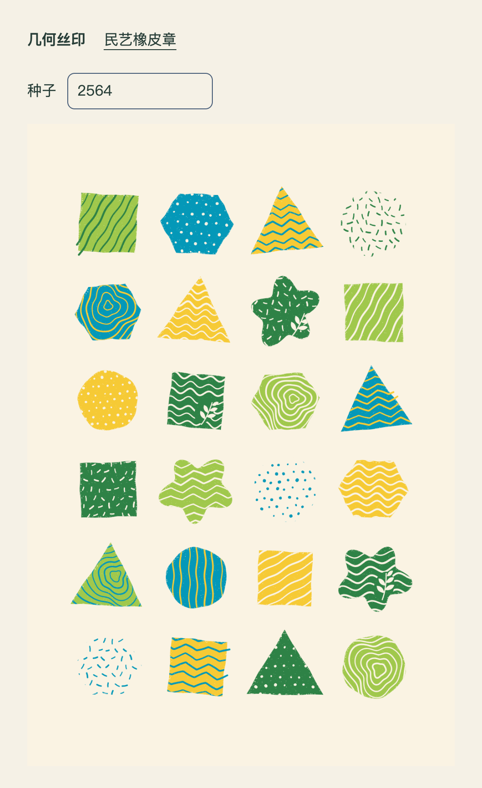

# Niltavi Banner

[简体中文](docs/README.zh-CN.md)

Niltavi Banner is a seeded artwork generator for Niltavi projects. It runs offline in a modern browser.

Open [Geometric Screenprint](index.html) for a four-color poster of 24 geometric motifs. Open [Folk Rubber Stamps](stamps.html) for 24 dark-green impressions in six rows and four vertically staggered columns. The default stamp seed `林间` begins with a ginkgo leaf, a snail, a mushroom, and an acorn. Enter an ID from the [50-motif catalog](docs/stamp-motifs.md) to place that motif first.

See the [integration guide](docs/en/for-agents.md) to use either renderer from code or run the checks.

Licensed under [MIT](LICENSE).

<a href="docs/en/for-agents.md">For Agents</a>
<a href="https://niltavi.com/">
<picture>
  <source media="(prefers-color-scheme: dark)" srcset="docs/assets/niltavi-logo-dark.svg" />
  
</picture>
</a>

