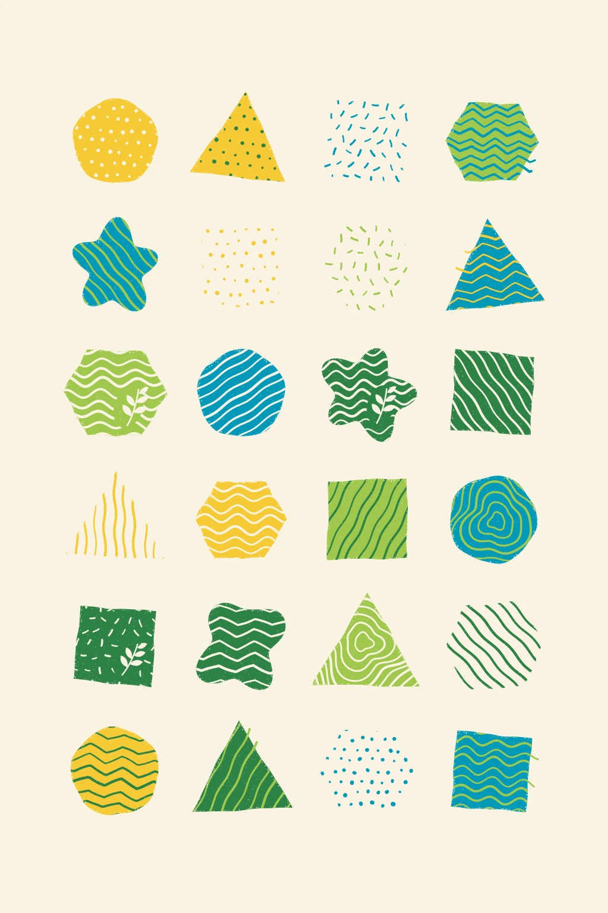
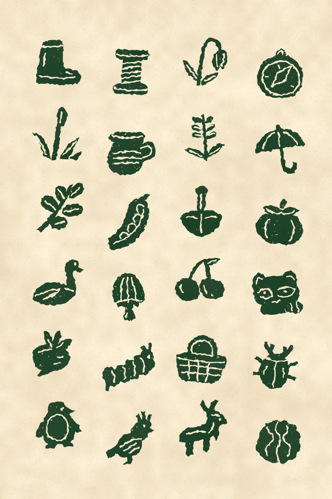
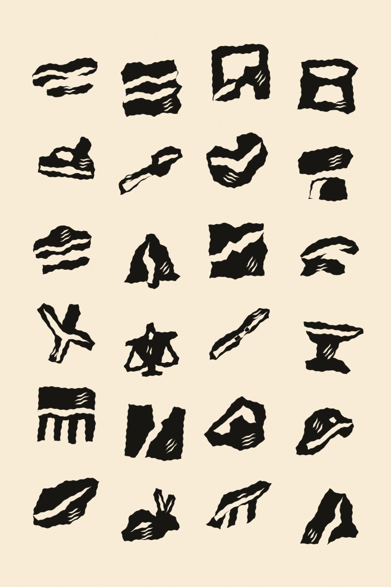

# Niltavi Banner · Series 2

三种风格各有 50 枚新图案。点击名称查看独立的 384 × 384 透明底 PNG。预览使用同样的四列六行和各风格原有的格距。

在本地文件地址后加上 `?series=2` 进入新目录，输入下表的种子可把对应图案放在左上角。原有入口会继续按旧目录解释种子。

## 几何丝印

[打开样张预览](../index.html?series=2&seed=%E6%96%B0%E4%BD%9C)

| 图案 | 种子 | 图案 | 种子 |
| --- | --- | --- | --- |
| [池纹](../assets/series-2/screenprint/pond-ripple.png) | `pond-ripple` | [黄折方](../assets/series-2/screenprint/yellow-switch.png) | `yellow-switch` |
| [日斑](../assets/series-2/screenprint/sun-grain.png) | `sun-grain` | [青蓝短划方](../assets/series-2/screenprint/blue-dashes.png) | `blue-dashes` |
| [草流](../assets/series-2/screenprint/grass-current.png) | `grass-current` | [水方](../assets/series-2/screenprint/water-square.png) | `water-square` |
| [短划圆](../assets/series-2/screenprint/chalk-disc.png) | `chalk-disc` | [草浪砖](../assets/series-2/screenprint/grass-wave-tile.png) | `grass-wave-tile` |
| [折日](../assets/series-2/screenprint/folded-sun.png) | `folded-sun` | [条纹窗](../assets/series-2/screenprint/striped-pane.png) | `striped-pane` |
| [蓝线圆](../assets/series-2/screenprint/blue-lattice.png) | `blue-lattice` | [湖格](../assets/series-2/screenprint/lake-cell.png) | `lake-cell` |
| [种盘](../assets/series-2/screenprint/seed-disc.png) | `seed-disc` | [柠檬六角](../assets/series-2/screenprint/citron-cell.png) | `citron-cell` |
| [柠檬等高线](../assets/series-2/screenprint/lemon-isobar.png) | `lemon-isobar` | [蜜点](../assets/series-2/screenprint/honey-dots.png) | `honey-dots` |
| [潮线圆](../assets/series-2/screenprint/tidal-disc.png) | `tidal-disc` | [六角折线](../assets/series-2/screenprint/staggered-cell.png) | `staggered-cell` |
| [青蓝短划圆](../assets/series-2/screenprint/blue-chalk.png) | `blue-chalk` | [草绿蜂格](../assets/series-2/screenprint/grass-honeycomb.png) | `grass-honeycomb` |
| [折返峰](../assets/series-2/screenprint/switchback.png) | `switchback` | [六角波沿](../assets/series-2/screenprint/brim-wave.png) | `brim-wave` |
| [黄浪峰](../assets/series-2/screenprint/yellow-wave-peak.png) | `yellow-wave-peak` | [棱格短线](../assets/series-2/screenprint/prism-dashes.png) | `prism-dashes` |
| [草绿点峰](../assets/series-2/screenprint/grass-pinpoint.png) | `grass-pinpoint` | [青蓝线肋](../assets/series-2/screenprint/blue-ribs.png) | `blue-ribs` |
| [等高峰](../assets/series-2/screenprint/contour-peak.png) | `contour-peak` | [镂空点格](../assets/series-2/screenprint/hollow-cell.png) | `hollow-cell` |
| [针线峰](../assets/series-2/screenprint/needle-peak.png) | `needle-peak` | [日光六角](../assets/series-2/screenprint/sun-cell.png) | `sun-cell` |
| [斜风峰](../assets/series-2/screenprint/crosswind-peak.png) | `crosswind-peak` | [浅绿小岛](../assets/series-2/screenprint/lime-islet.png) | `lime-islet` |
| [柠檬条峰](../assets/series-2/screenprint/citron-stripes.png) | `citron-stripes` | [泡沫洼](../assets/series-2/screenprint/foam-pocket.png) | `foam-pocket` |
| [水纹峰](../assets/series-2/screenprint/ripple-peak.png) | `ripple-peak` | [枝叶岛](../assets/series-2/screenprint/sprig-islet.png) | `sprig-islet` |
| [静峰](../assets/series-2/screenprint/quiet-peak.png) | `quiet-peak` | [晴岛](../assets/series-2/screenprint/open-islet.png) | `open-islet` |
| [黄点峰](../assets/series-2/screenprint/yellow-pinpoint.png) | `yellow-pinpoint` | [折线水洼](../assets/series-2/screenprint/folded-puddle.png) | `folded-puddle` |
| [窗纹](../assets/series-2/screenprint/window-ripple.png) | `window-ripple` | [浅绿曲岸](../assets/series-2/screenprint/lime-bank.png) | `lime-bank` |
| [草编方](../assets/series-2/screenprint/grass-weave.png) | `grass-weave` | [花圃点纹](../assets/series-2/screenprint/garden-dots.png) | `garden-dots` |
| [柠檬点方](../assets/series-2/screenprint/lemon-check.png) | `lemon-check` | [黄沙等高线](../assets/series-2/screenprint/yellow-layers.png) | `yellow-layers` |
| [方园](../assets/series-2/screenprint/garden-square.png) | `garden-square` | [蓝岸条纹](../assets/series-2/screenprint/blue-strand.png) | `blue-strand` |
| [浅绿地形](../assets/series-2/screenprint/lime-topography.png) | `lime-topography` | [草地折线](../assets/series-2/screenprint/grass-fold.png) | `grass-fold` |

## 民艺橡皮章

[打开样张预览](../stamps.html?series=2&seed=%E6%96%B0%E4%BD%9C)

| 图案 | 种子 | 图案 | 种子 |
| --- | --- | --- | --- |
| [桦叶](../assets/series-2/stamp/birch-leaf.png) | `birch-leaf` | [戴胜](../assets/series-2/stamp/hoopoe.png) | `hoopoe` |
| [鸢尾](../assets/series-2/stamp/iris.png) | `iris` | [天鹅](../assets/series-2/stamp/swan.png) | `swan` |
| [雪滴花](../assets/series-2/stamp/snowdrop.png) | `snowdrop` | [企鹅](../assets/series-2/stamp/penguin.png) | `penguin` |
| [薰衣草](../assets/series-2/stamp/lavender.png) | `lavender` | [野鸭](../assets/series-2/stamp/duck.png) | `duck` |
| [桉枝](../assets/series-2/stamp/eucalyptus.png) | `eucalyptus` | [鼬](../assets/series-2/stamp/weasel.png) | `weasel` |
| [蒲公英](../assets/series-2/stamp/dandelion.png) | `dandelion` | [浣熊](../assets/series-2/stamp/raccoon.png) | `raccoon` |
| [榛子](../assets/series-2/stamp/hazelnut.png) | `hazelnut` | [田鼠](../assets/series-2/stamp/field-mouse.png) | `field-mouse` |
| [核桃](../assets/series-2/stamp/walnut.png) | `walnut` | [绵羊](../assets/series-2/stamp/sheep.png) | `sheep` |
| [石榴](../assets/series-2/stamp/pomegranate.png) | `pomegranate` | [山羊](../assets/series-2/stamp/goat.png) | `goat` |
| [无花果](../assets/series-2/stamp/fig.png) | `fig` | [野猪](../assets/series-2/stamp/boar.png) | `boar` |
| [柿子](../assets/series-2/stamp/persimmon.png) | `persimmon` | [海马](../assets/series-2/stamp/seahorse.png) | `seahorse` |
| [樱桃](../assets/series-2/stamp/cherries.png) | `cherries` | [章鱼](../assets/series-2/stamp/octopus.png) | `octopus` |
| [柠檬](../assets/series-2/stamp/lemon.png) | `lemon` | [水母](../assets/series-2/stamp/jellyfish.png) | `jellyfish` |
| [葡萄](../assets/series-2/stamp/grapes.png) | `grapes` | [海星](../assets/series-2/stamp/starfish.png) | `starfish` |
| [豌豆荚](../assets/series-2/stamp/pea-pod.png) | `pea-pod` | [双壳蛤](../assets/series-2/stamp/clam.png) | `clam` |
| [小萝卜](../assets/series-2/stamp/radish.png) | `radish` | [雨伞](../assets/series-2/stamp/umbrella.png) | `umbrella` |
| [大蒜](../assets/series-2/stamp/garlic.png) | `garlic` | [线轴](../assets/series-2/stamp/spool.png) | `spool` |
| [甜椒](../assets/series-2/stamp/pepper.png) | `pepper` | [雨靴](../assets/series-2/stamp/boot.png) | `boot` |
| [鬼伞](../assets/series-2/stamp/inkcap.png) | `inkcap` | [编篮](../assets/series-2/stamp/basket.png) | `basket` |
| [香菇](../assets/series-2/stamp/shiitake.png) | `shiitake` | [陶罐](../assets/series-2/stamp/pitcher.png) | `pitcher` |
| [锹甲](../assets/series-2/stamp/stag-beetle.png) | `stag-beetle` | [折扇](../assets/series-2/stamp/paper-fan.png) | `paper-fan` |
| [蟋蟀](../assets/series-2/stamp/cricket.png) | `cricket` | [罗盘](../assets/series-2/stamp/compass.png) | `compass` |
| [毛毛虫](../assets/series-2/stamp/caterpillar.png) | `caterpillar` | [香蒲叶](../assets/series-2/stamp/cattail-leaves.png) | `cattail-leaves` |
| [萤火虫](../assets/series-2/stamp/firefly.png) | `firefly` | [露珠叶](../assets/series-2/stamp/dew-leaf.png) | `dew-leaf` |
| [翠鸟](../assets/series-2/stamp/kingfisher.png) | `kingfisher` | [园艺铲](../assets/series-2/stamp/garden-trowel.png) | `garden-trowel` |

## 现代主义木刻

[打开样张预览](../woodcut.html?series=2&seed=%E6%96%B0%E4%BD%9C)

| 图案 | 种子 | 图案 | 种子 |
| --- | --- | --- | --- |
| [信号焰](../assets/series-2/woodcut/signal-flare.png) | `signal-flare` | [刀羽](../assets/series-2/woodcut/quill.png) | `quill` |
| [阶坝](../assets/series-2/woodcut/stepped-dam.png) | `stepped-dam` | [舷窗](../assets/series-2/woodcut/porthole.png) | `porthole` |
| [剪浪燕鸥](../assets/series-2/woodcut/tern.png) | `tern` | [地峡](../assets/series-2/woodcut/isthmus.png) | `isthmus` |
| [压顶石](../assets/series-2/woodcut/capstone.png) | `capstone` | [折焰蜡烛](../assets/series-2/woodcut/angular-candle.png) | `angular-candle` |
| [鲸尾](../assets/series-2/woodcut/whale-tail.png) | `whale-tail` | [水闸](../assets/series-2/woodcut/sluice.png) | `sluice` |
| [阵风](../assets/series-2/woodcut/gust.png) | `gust` | [折坡](../assets/series-2/woodcut/ramp.png) | `ramp` |
| [折檐](../assets/series-2/woodcut/folded-roof.png) | `folded-roof` | [层云](../assets/series-2/woodcut/shelf-cloud.png) | `shelf-cloud` |
| [木刨](../assets/series-2/woodcut/hand-plane.png) | `hand-plane` | [碎石坡](../assets/series-2/woodcut/talus.png) | `talus` |
| [破口](../assets/series-2/woodcut/breach.png) | `breach` | [三脚座](../assets/series-2/woodcut/tripod.png) | `tripod` |
| [栈桥](../assets/series-2/woodcut/pier.png) | `pier` | [折苇](../assets/series-2/woodcut/reed-fan.png) | `reed-fan` |
| [霜楔](../assets/series-2/woodcut/frost-wedge.png) | `frost-wedge` | [羽翼印](../assets/series-2/woodcut/wing-seal.png) | `wing-seal` |
| [滑轮](../assets/series-2/woodcut/pulley.png) | `pulley` | [长栓](../assets/series-2/woodcut/bolt.png) | `bolt` |
| [角鸮面](../assets/series-2/woodcut/owl-mask.png) | `owl-mask` | [方位芒](../assets/series-2/woodcut/compass-rose.png) | `compass-rose` |
| [楔船](../assets/series-2/woodcut/wedge-boat.png) | `wedge-boat` | [切角纸](../assets/series-2/woodcut/folded-corner.png) | `folded-corner` |
| [裂铃](../assets/series-2/woodcut/split-bell.png) | `split-bell` | [沙洲](../assets/series-2/woodcut/sandbar.png) | `sandbar` |
| [屋脊天窗](../assets/series-2/woodcut/roof-vent.png) | `roof-vent` | [木笛](../assets/series-2/woodcut/flute.png) | `flute` |
| [隔扇日光](../assets/series-2/woodcut/sun-shutter.png) | `sun-shutter` | [钩喙](../assets/series-2/woodcut/hook-beak.png) | `hook-beak` |
| [俯身野兔](../assets/series-2/woodcut/grazing-hare.png) | `grazing-hare` | [铁砧](../assets/series-2/woodcut/anvil.png) | `anvil` |
| [岬角](../assets/series-2/woodcut/headland.png) | `headland` | [裂贝](../assets/series-2/woodcut/split-shell.png) | `split-shell` |
| [裂谷](../assets/series-2/woodcut/ravine.png) | `ravine` | [井口](../assets/series-2/woodcut/well-mouth.png) | `well-mouth` |
| [木心](../assets/series-2/woodcut/heartwood.png) | `heartwood` | [石织机](../assets/series-2/woodcut/stone-loom.png) | `stone-loom` |
| [折页百叶](../assets/series-2/woodcut/shutter-fold.png) | `shutter-fold` | [折扇门](../assets/series-2/woodcut/fold-gate.png) | `fold-gate` |
| [风向标](../assets/series-2/woodcut/weathervane.png) | `weathervane` | [斜礁](../assets/series-2/woodcut/raked-reef.png) | `raked-reef` |
| [垂钩](../assets/series-2/woodcut/gravity-hook.png) | `gravity-hook` | [截枝](../assets/series-2/woodcut/cut-branch.png) | `cut-branch` |
| [齿梳](../assets/series-2/woodcut/comb.png) | `comb` | [秤盘](../assets/series-2/woodcut/scale-pan.png) | `scale-pan` |
